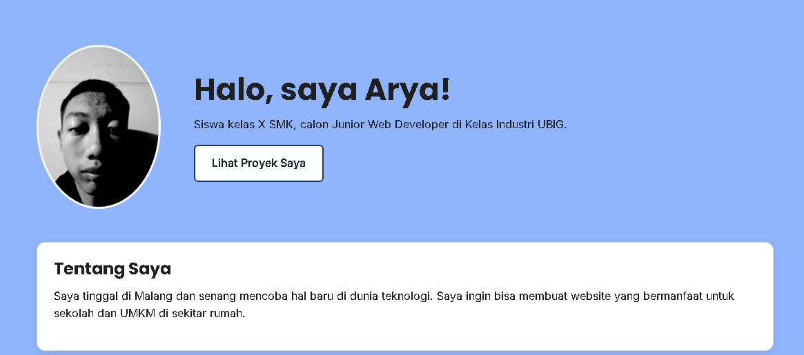

# Portofolio Arya Wahyu Dwi Prasetyo
Website portofolio pribadi yang saya buat di Kelas Industri UBIG (Paket 1, Minggu 01 sampai 05).
Website ini tampil rapi di ponsel, tablet, dan laptop.
## Tampilan

## Fitur
- Halaman **Beranda** berisi profil, hobi, cita-cita, keahlian, dan jadwal belajar
- Halaman **Proyek** berisi daftar proyek dalam bentuk kartu
- Halaman **Kontak** berisi form untuk menghubungi saya
- Tampilan responsif dengan Flexbox dan *media query*
## Teknologi
- HTML5
- CSS3 (Flexbox dan media query)
- Git dan GitHub
## Tautan
- Website: menyusul setelah *deploy* ke Vercel
<<<<<<< HEAD
- Dibuat oleh: Arya Wahyu Dwi Prasetyo, SMKS Brantas Karangkates